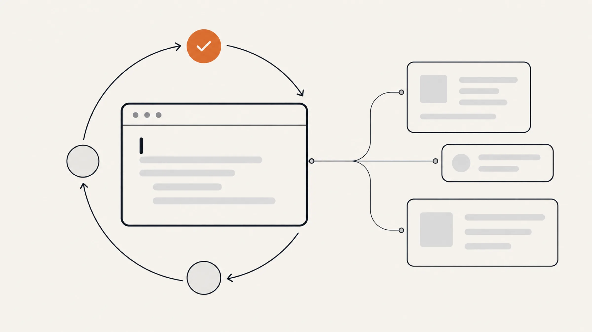
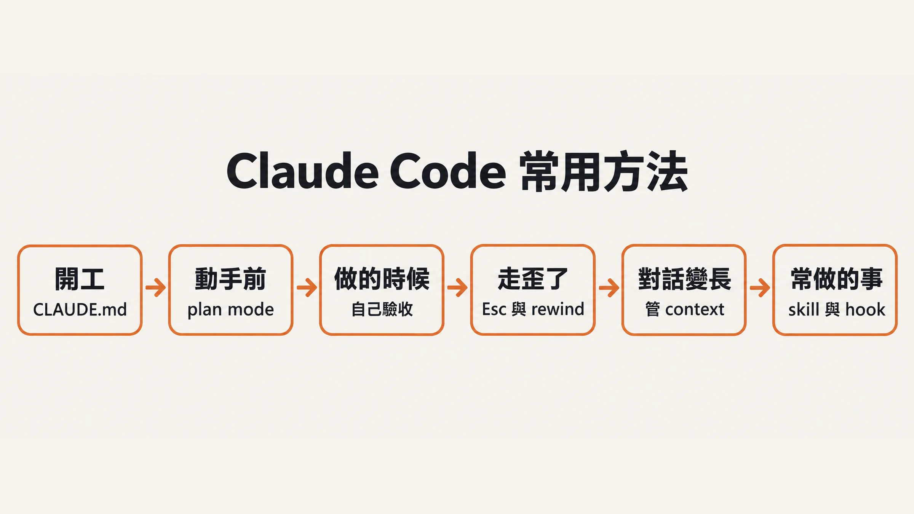
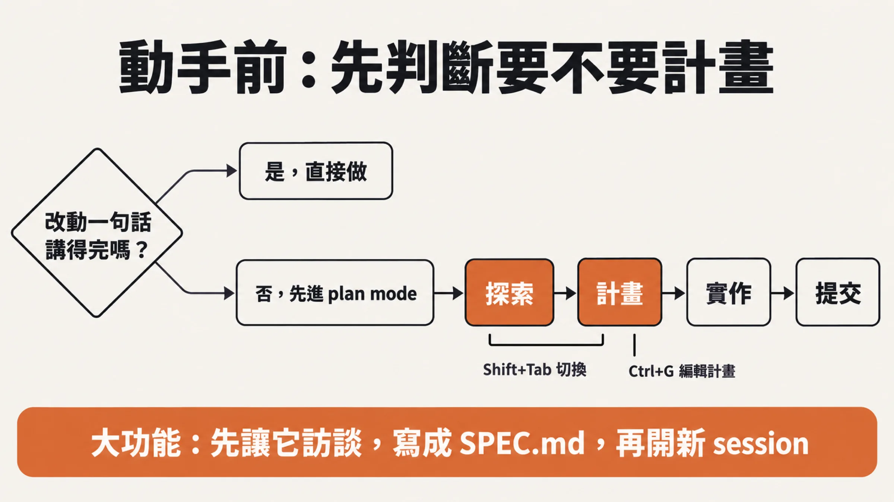
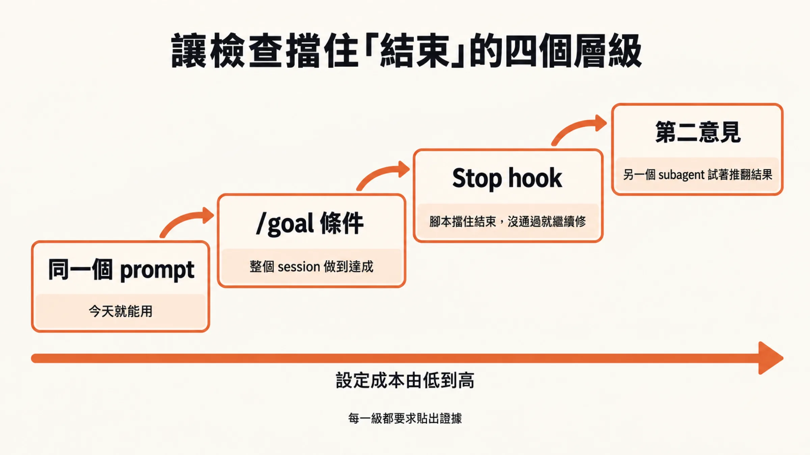
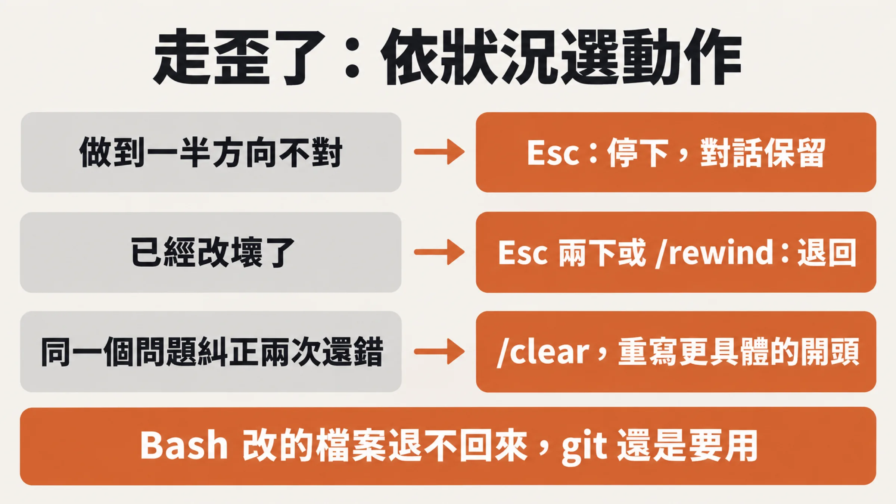
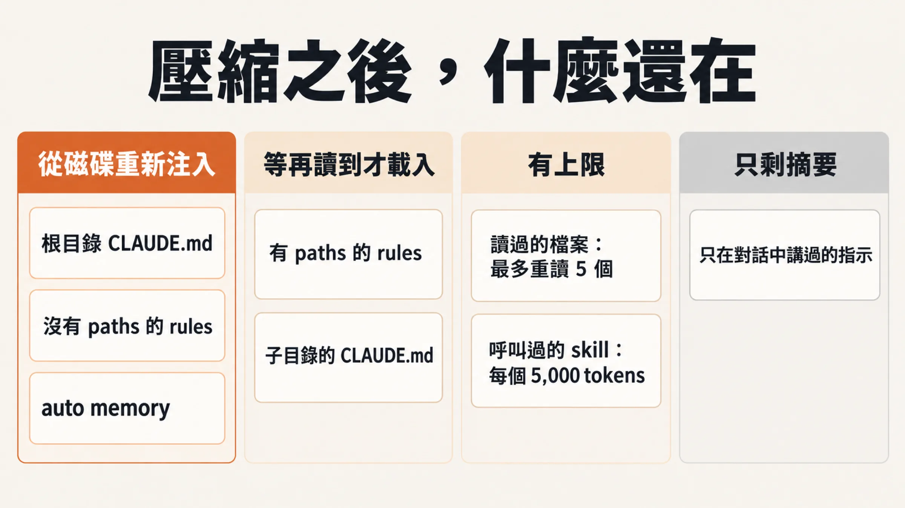
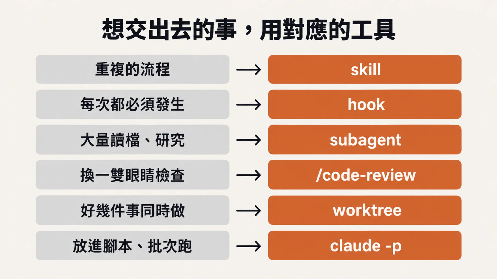

# Claude Code 常用方法：遇到什麼情況，該用哪一招



官方 [Best practices](https://code.claude.com/docs/en/best-practices) 開頭就點明：大部分建議都來自同一個限制，Claude 的 context window 會很快填滿，而且越滿，表現越差。一次除錯或一次程式庫探索，就可能吃掉數萬個 token。context 裡裝著整段對話、每個讀過的檔案、每次指令的輸出，滿了以後 Claude 會開始「忘記」前面的指示，錯誤也變多。

這句話解釋了不少日常現象：聊久了它變笨、同一個錯糾正三次還是錯、規則寫了它偏偏漏掉一條。官方最佳實踐的第一節還有另一個提示：給 Claude 一個它自己能跑的檢查，你就不必一直盯著它。

本文把常用方法依你實際的工作順序整理成六個情境：開工、動手前、做的時候、走歪了、對話變長、常做的事想交出去。每個情境告訴你什麼時候用、怎麼打、哪裡容易踩坑。事實與指令以官方文件為準，文中附連結；沒特別註明的建議，都出自文末列出的官方文件。EP431 影片的說法只用來決定取材順序，引用時會標明。



*六個情境，依你實際的工作順序排列。*

## 一、開工：先讓它認識你的專案

### 什麼時候用

新專案第一次開 Claude Code，或是發現它老是犯同一類錯、問你已經寫過的事。

### 怎麼打

在專案資料夾裡執行：

```text
/init
```

[`/init`](https://code.claude.com/docs/en/best-practices) 會分析你的程式庫，產出一份起始的 CLAUDE.md；專案已經有的話，它只會提出改進建議，不會直接覆蓋。CLAUDE.md 是 Claude 每個 session 開頭都會讀的檔案。

草稿出來之後，真正的工作是刪。官方給的判斷標準是對每一行問：拿掉它，Claude 會做錯嗎？不會就刪。

留下來的，像是跑單一測試的指令（例如 `npm run test:unit -- <檔名>`）、跟預設不同的程式風格、分支命名與 PR 規則、必要的環境變數這類環境的坑。刪掉的，是讀程式碼就看得出來的東西（用了哪個框架）、「寫乾淨的程式碼」這種不言自明的話、逐檔案的說明，還有會常變動的資訊。


*CLAUDE.md 的取捨：只留 Claude 從程式碼猜不到的。*

接著是「給它看」。與其描述，不如直接給它材料：

- 用 `@src/auth/login.ts` 指定檔案，它會先讀再回答。
- 畫面跑版就貼截圖。
- 出錯時貼整段錯誤訊息，再加一句：`fix it and verify the build succeeds. address the root cause, don't suppress the error`（中文也行：修好它、確認 build 會過、修根本原因，不要把錯誤藏起來）。只說「build 壞了」，它得自己到處找。
- 要碰 GitHub 就裝好 `gh`。CLI 工具是跟外部服務互動最省 context 的方式。

提示本身也要說具體。官方在 Best practices 列了四種改寫方向：

| 做法 | 含糊的說法 | 具體的說法 |
|---|---|---|
| 限定範圍 | `add tests for foo.py` | `write a test for foo.py covering the edge case where the user is logged out. avoid mocks.` |
| 指向來源 | `why does ExecutionFactory have such a weird api?` | `look through ExecutionFactory's git history and summarize how its api came to be` |
| 參照既有寫法 | `add a calendar widget` | 指向首頁既有的 widget（官方範例是 `HotDogWidget.php`），要求照那個模式做，且不引入專案沒用過的函式庫（節錄） |
| 描述症狀 | `fix the login bug` | `users report that login fails after session timeout. check the auth flow in src/auth/, especially token refresh. write a failing test that reproduces the issue, then fix it` |

官方也說，含糊的 prompt 在探索階段有它的用處，例如問「這個檔案有什麼可以改進」，可能挖出你沒想到要問的事。

### 常見踩坑

**CLAUDE.md 越寫越長。** 每份 CLAUDE.md 建議控制在 200 行內，更長會佔用 context，並降低 Claude 遵守的程度（[memory 頁](https://code.claude.com/docs/en/memory)）。規則一直被漏掉，多半是檔案太長、重要的那條被淹沒了。

**用 `@import` 想省 context。** `@path/to/file` 可以把其他檔案引進來，方便整理，卻不會減少佔用，引進來的內容一樣在每個 session 載入。

**不確定它有沒有讀到。** 執行 `/context`，在 Memory files 清單裡確認你的 CLAUDE.md 有被載入；清單裡沒有，Claude 就看不到。

**每條規則都標 IMPORTANT。** 只對真的一直被跳過的那一行加強調；全部都強調，等於都沒強調。

**把 CLAUDE.md 當成保證。** 官方明說它是 context，不是強制設定。規則被漏掉時的處理順序：先刪減檔案，仍然漏掉就對那一行單獨加強調，某件事必須每次都發生，才改用第六章的 hook。

另外，已經入版控的 CLAUDE.md 可以跑 [`/doctor`](https://code.claude.com/docs/en/best-practices)，Claude 會提議刪掉那些它從程式碼就能推出來的內容。

### 今天可以做的一件事

跑一次 `/init`，把草稿刪到只剩它自己猜不到的東西，再用 `/context` 確認載入。

## 二、動手前：先想清楚，再讓它改

### 什麼時候用

要改好幾個檔案、不熟悉那段程式碼，或你自己也還沒想好怎麼做的時候。反過來，如果你能用一句話講完這次的 diff，例如改錯字、換變數名稱，就直接叫它做，跳過計畫。計畫本身也有成本。

### 怎麼打

按 `Shift+Tab` 切換模式。在 [permission modes](https://code.claude.com/docs/en/permission-modes) 頁裡，畫面底部的狀態列會依序顯示 `auto mode on`、`manual mode on`、`accept edits on`、`plan mode on`，再回到 auto。進入 plan mode 後，Claude 只研究與提出計畫，不改你的原始碼（它仍會跑指令來探索）。

流程分四步（節錄自官方範例）：

```text
（plan mode）read /src/auth and understand how we handle sessions and login. also look at how we manage environment variables for secrets.
（plan mode）I want to add Google OAuth. What files need to change? What's the session flow? Create a plan.
（離開 plan mode）implement the OAuth flow from your plan. write tests for the callback handler, run the test suite and fix any failures.
commit with a descriptive message and open a PR
```

計畫出來後按 `Ctrl+G`，可以在編輯器裡直接改計畫，再讓 Claude 繼續。



*要不要先計畫，以及 plan mode 的流程。*

**規模更大的功能，先讓它訪談你。** 下面這段 prompt 可以直接套用：

```text
I want to build [簡述功能]. Interview me in detail using the AskUserQuestion tool.
Ask about technical implementation, UI/UX, edge cases, concerns, and tradeoffs.
Don't ask obvious questions, dig into the hard parts I might not have considered.
Keep interviewing until we've covered everything, then write a complete spec to SPEC.md.
```

Claude 會用選擇題問你。問完、規格寫進 `SPEC.md` 之後，開一個全新的 session 來實作：新 session 的 context 乾淨，空間都留給寫程式。規格的好壞標準是：最有用的規格會寫明涉及的檔案與介面、哪些事不在範圍內，並以一個端到端的驗證步驟收尾。

**模型與思考深度。** `/model` 換模型，`/effort` 調思考深度，等級從低到高是 `low`、`medium`、`high`、`xhigh`、`max`。Opus 5.5、Sonnet 5.5 與 Haiku 5.5 的預設都是 `medium`，其他多數模型的預設是 `high`（[model-config 頁](https://code.claude.com/docs/en/model-config)）。官方在 [costs 頁](https://code.claude.com/docs/en/costs)的建議是：Sonnet 能處理大部分寫程式的工作，也比較便宜；複雜的架構決定或需要多步推理的，再換 Opus。`opusplan` 這個設定則讓 plan mode 用 Opus 規劃，開始執行時自動換回 Sonnet。

### 常見踩坑

**以為每台機器的預設都是 auto。** Claude Code v2.1.283 以上的互動式終端機與 VS Code session，內建起始模式就是 auto mode（要有支援的模型，組織也可以關閉）；更舊的版本只有 Pro、Max、Team 方案是。auto 模式由另一個分類器模型審查動作，只攔看起來有風險的。它也有煞車：連續被擋 3 次、或同一次 session 累計被擋 20 次，就會退回逐次詢問，這兩個門檻不能調整；核准被詢問的那個動作後，會回到 auto。

**沒有 auto mode，就會點到麻木。** Manual 模式每個動作都問，問到第十次，你只是在按確認。對策有兩個：用 `/permissions` 預先放行信得過的工具（例如 `npm run lint`、`git commit`），以及用 `/sandbox` 讓沙箱內的指令不必再問。

**每件小事都先 plan。** 計畫有額外成本。範圍清楚、改動很小的事直接做。

**effort 越高越好。** 低 effort 對簡單工作又快又省，高 effort 用在複雜問題；預設值適合大部分寫程式的工作，想換個平衡再調。另外，Opus 4.6 與 Sonnet 4.6 沒有 `xhigh`，Haiku 4.5、Sonnet 4.5 則不支援 effort 設定。

**在同一個 session 裡訪談完直接寫。** 規格寫完就開新 session，新的 context 才是乾淨的。

### 今天可以做的一件事

下一個要改多個檔案的任務，先按 `Shift+Tab` 切到 plan mode（或在單一 prompt 前面加 `/plan`），讓它列計畫給你看，再決定要不要放行。

## 三、做的時候：讓它自己驗收

### 什麼時候用

幾乎每一次。官方把這條放在最佳實踐的第一位，原因很直接：Claude 覺得做完了就會停下來，如果它手上沒有任何可以檢查的東西，「看起來做完了」就是唯一的訊號，於是你成了唯一的檢查機制，每個錯誤都得等你發現。給它一個會回報通過或失敗的檢查，這個循環就能自己跑完：它做事、跑檢查、讀結果、再改，直到通過。

### 怎麼打

檢查可以是任何 Claude 在對話裡讀得到結果的東西：測試、build 的結束碼、linter、把輸出跟範本比對的腳本，或把瀏覽器截圖跟設計稿對照。官方在 [Best practices](https://code.claude.com/docs/en/best-practices) 給了三組改寫範例：

| 原本的講法 | 改成 |
|---|---|
| 「寫一個驗證 email 的函式」 | 「寫 `validateEmail`。範例：`user@example.com` 要通過，`invalid` 與 `user@.com` 要擋下。寫完跑測試」 |
| 「讓 dashboard 好看一點」 | 「[貼設計稿] 照這個實作，完成後截圖跟原圖比對，列出差異並修掉」 |
| 「build 壞了」 | 「build 出現這個錯誤：[貼錯誤]。修好並確認 build 會過，要處理根本原因，不要把錯誤藏起來」 |

檢查準備好之後，你可以決定它多用力擋住「結束」。官方列了四級，成本由低到高：

1. **同一個 prompt 裡**：直接要求它跑檢查並反覆修改，任何任務今天就能用。
2. **整個 session**：用 `/goal` 設定條件，每一輪結束後由另一個模型檢查條件是否成立，沒成立 Claude 就繼續。
3. **確定性的關卡**：用 Stop hook 跑你自己的腳本，檢查沒過就不讓這一輪結束。
4. **第二意見**：讓一個全新的 subagent 或 workflow 試著推翻結果，寫程式的那個 Claude 就不是打分數的人。



*讓檢查擋住「結束」的四個層級，設定成本由低到高。*

`/goal` 的寫法很實用：

```text
/goal all tests in test/auth pass and the lint step is clean, or stop after 20 turns
```

[goal 頁](https://code.claude.com/docs/en/goal)建議條件包含三件事：一個可量測的終點（測試結果、build 結束碼、佇列清空）、證明它的方式（例如「`npm test` exits 0」）、不能動到的限制（例如「不修改其他測試檔」）。條件上限 4,000 字元，一個 session 同時只有一個 goal；後面加上輪數或時間的子句，可以替它設上限。輸入 `/goal` 不帶參數就能看目前狀態，執行中按 `Ctrl+O` 能看到評估者每次判斷的理由。

不管用哪一級，都要求它把證據貼出來：測試輸出、跑了哪個指令、回了什麼結果、或截圖。官方的理由是，看證據比自己重跑一遍快，而且對你沒在盯的 session 也有效。

### 常見踩坑

**以為 `/goal` 的評估者會自己去驗證。** 它不會跑指令，也不會讀檔，只看 Claude 在對話裡已經呈現的內容。所以條件要寫成 Claude 自己的輸出能證明的東西。「所有測試通過」可行，因為 Claude 會跑測試、結果會出現在對話裡；「程式沒有 bug」不可行。

**設了 `/goal` 就放心離開。** `/goal` 不會改你的權限模式。在 Manual 模式下，Claude 遇到設定沒放行的工具呼叫還是會停下來問你；要讓它真的無人看管，得在 auto mode 下設定。另外，如果 Claude 連續好幾輪沒有進展（都沒用工具），Claude Code 會停下迴圈、印出警告，把控制權交還你，goal 仍然保留。

**Stop hook 擋不完。** 上限是連續擋 8 次：Stop hook 讓同一輪連續繼續八次之後，Claude Code 會放行結束；每次 Claude 呼叫一次工具，計數就歸零。真的需要更多次，可以用環境變數 `CLAUDE_CODE_STOP_HOOK_BLOCK_CAP` 調高。你的腳本還要讀輸入 JSON 裡的 `stop_hook_active` 欄位，為 `true` 就直接放行（exit 0），官方範例用 `jq -r '.stop_hook_active'` 判斷，否則容易一直擋。照這個寫法，同一次停止嘗試只會擋一次：Claude 修了還沒修好，第二次想結束就放行了。想要重試到通過，可以不看這個欄位、自己計數設上限，我的作法見文末「我自己多做的幾招」。

**產出看起來合理就收工。** 官方在失敗模式裡寫得很直白：Claude 會生出一份看起來合理、卻沒處理邊界情況的實作。對策只有一條，永遠給驗證；你無法驗證的東西，就別出貨。

### 今天可以做的一件事

下一個任務，在 prompt 最後加一句「寫完跑測試，把輸出貼給我」。

## 四、走歪了：把它收回來

### 什麼時候用

Claude 做到一半，你發現方向不對；或它已經改壞了；或同一個問題你糾正了兩次，它還是錯。

### 怎麼打

原則是早糾正、常糾正。最好的結果來自很緊的回饋迴圈，Claude 偶爾能一次做對，但及早修正通常更快得到好結果。手上有四個動作：

- **`Esc`**：在 Claude 做事的中途停下它。已經做的事和 context 都保留，你可以直接告訴它改往哪裡走。
- **`Esc` 兩下，或 `/rewind`**：開啟還原選單，把對話、程式碼，或兩者，退回到先前任何一次你送出訊息的時間點。
- **「Undo that」**：直接叫它把剛剛的改動還原。
- **`/clear`**：在兩件不相關的事之間重置 context。



*走歪了的三種狀況，各用不同的動作收回來。*

[checkpointing 頁](https://code.claude.com/docs/en/checkpointing)說明，rewind 選單有六個選項：還原程式碼與對話、只還原對話、只還原程式碼、Summarize from here、Summarize up to here，以及取消。其中 Summarize from here 與 Summarize up to here 是「壓縮」：把某個點之後（或之前）的對話壓成摘要，騰出空間，同時保留你要的那一邊，比直接 `/compact` 精準。選擇還原對話或 Summarize from here 之後，那則 prompt 會放回輸入框，讓你重新送出或修改；Summarize up to here 則停在對話尾端，輸入框是空的。

有了 rewind，你就可以放手叫 Claude 試有風險的做法：不行就退回去，不必事先規劃每一步。checkpoint 會跟著對話一起保存，所以關掉終端機、之後 resume，一樣可以 rewind。

**糾正兩次的規則。** 同一個問題在一個 session 裡糾正超過兩次，context 裡就塞滿了失敗的做法，Claude 會一直被拉回去。做法是 `/clear`，然後寫一個更具體、把剛剛學到的事放進去的開頭。乾淨的對話配上更好的 prompt，幾乎都贏過一段被糾正很多次的長對話。

### 常見踩坑

**用 rewind 想救被指令改掉的東西。** checkpoint 只追蹤 Claude 檔案編輯工具所做的改動。Claude 用 Bash 跑 `rm`、`mv`、`cp` 這類指令改動的檔案，不在記錄裡；外部程序的改動也不在。官方直接說，它不能取代 git。叫 Claude 試有風險的做法之前，先確定該 commit 的有 commit。

**輸入框有字時按兩下 Esc。** 這時兩下 `Esc` 會清掉你的草稿，不會開 rewind 選單。被清掉的文字存在輸入歷史裡，按 `Up` 能叫回來。

**以為 checkpoint 永遠在。** 每個 session 保留最近 100 個 checkpoint 的檔案快照；快照預設在 session 最後一次儲存後約 30 天被清掃，之後再 rewind 可能出現 `No files were restored`。需要更久可以調整 `cleanupPeriodDays`。

**subagent 的修改通常不在 checkpoint 裡。** 一般的 subagent，包括背景執行的 `/code-review --fix`，做的編輯多半不會被收進你 session 的 checkpoint；之後 `/rewind` 只會還原 Claude 已經在對話裡編輯過的檔案，其餘要用 git 處理。

**把 `/clear` 當成不可逆。** 同一個 Claude Code 行程裡，`/clear` 之後打開 rewind 選單，最上面會多出一條 `/resume <session-id> (previous session)`，可以回到清除前的對話，直到你離開或換到另一個 session。

**一路糾正下去，不重來。** 官方列為常見的失敗模式之一。兩次還是錯，就換成重開。

### 今天可以做的一件事

下次它走偏時，先按一下 `Esc`，用一句話說明改往哪裡走；如果同一件事已經糾正過兩次，改用 `/clear` 加一個更具體的開頭。

## 五、對話變長：管好 context

### 什麼時候用

對話拉長之後，Claude 開始漏掉先前講過的事；或你只是想問個小問題，不想把它塞進主對話。

### 怎麼打

先看現況。`/context` 會用分類的方式顯示目前用量，並給出最佳化建議，包括哪些 CLAUDE.md 與 auto memory 檔案有載入。再決定怎麼收。

- **換一件不相關的事之前，`/clear`。** 官方把「一個 session 裡做 A、順口問 B、再回去做 A」叫作廚房水槽式的 session，context 裡塞滿用不到的東西。
- **快滿時，自己決定留什麼。** Claude Code 接近上限時會自動壓縮，你也可以先出手：`/compact focus on the API changes`，摘要就會保留你指定的重點。要壓縮一半，用 `/rewind` 選一則訊息，再選 Summarize from here 或 Summarize up to here。想調整自動壓縮的時機，用 `/autocompact 500k` 這類寫法設定 context 填到多滿才觸發；這個值會存進 user settings，之後所有專案都生效。
- **問小事，用 `/btw`。** 例如 `/btw what was the name of that config file again?`。這一問一答不會進入對話歷史，所以不佔空間；Claude 還在工作時也能問，且不會打斷它。它沒有任何工具，只能回答對話裡已經有的東西，不能讀檔或跑指令；要它去查新的東西，改用 subagent。
- **大量閱讀，交給 subagent。** 在要求前面加一句：`Use subagents to investigate how our authentication system handles token refresh, and whether we have any existing OAuth utilities I should reuse.` subagent 在自己獨立的 context window 裡讀檔，讀完只把摘要帶回來，主對話留給真正要改的部分。調查前先限定範圍，否則 Claude 可能讀上百個檔案把 context 塞滿，官方把這叫作無止境的探索。
- **一件事一個對話，並且命名。** 工作會橫跨好幾天時，用 `/rename oauth-migration` 取個看得懂的名字。隔天用 `claude --continue` 接回最近一個對話，或 `claude --resume` 開選單挑。官方的比喻是把每個名字當成一條分支：每條工作線有自己持續的 context。

壓縮之後，哪些東西還在？[context-window 頁](https://code.claude.com/docs/en/context-window)有一張完整的表，整理成下圖：




*壓縮之後，什麼還在。*

兩個上限的細節：讀過或改過的檔案，最多重讀 5 個，挑最近改過的，超過 5,000 tokens 的只留路徑；叫用過的 skill，每個上限 5,000 tokens，合計 25,000，最舊的先被丟掉。

### 常見踩坑

**以為要靠「壓縮指示」才保得住 CLAUDE.md。** 官方確實說可以在 CLAUDE.md 寫像 `When compacting, always preserve the full list of modified files and any test commands` 這樣的指示，來引導摘要保留什麼。不過從上表看，專案根目錄的 CLAUDE.md 本來就會在壓縮後從磁碟重新注入；真正會在壓縮裡消失的是只在對話中講過的指示，以及按需載入的子目錄規則。必須撐過壓縮的規則，拿掉 `paths:` 或放進根目錄 CLAUDE.md。

**把重要指示放在 skill 的後面。** 超過上限的 skill 在壓縮後會被截斷，截斷是保留開頭，所以最重要的指令要寫在 `SKILL.md` 的最前面。

**一份對話跑到底。** `/clear` 要常用。長 session 裡累積無關內容會降低表現。

**接回對話，卻找不到。** `claude --resume` 的選單預設只列目前 worktree 的對話。對話存在你的電腦上，預設保留 30 天。

### 今天可以做的一件事

做完一件事就打 `/clear`；下次想問個不相關的小問題，改用 `/btw`。

## 六、常做的事：交出去

前五章處理的是「這一次怎麼做好」。這一章處理你每週都在重複的事：把它們寫下來，讓 Claude 自己接手。



*想交出去的事，對應的工具。*

### Skill：把重複的流程寫成一個指令

**什麼時候用**：同一套步驟你做了好幾次，例如修 GitHub issue、寫 PR 說明。

**怎麼打**：在 `.claude/skills/<名字>/` 底下放一個 `SKILL.md`。官方範例：

```markdown
---
name: fix-issue
description: Fix a GitHub issue
disable-model-invocation: true
---
Analyze and fix the GitHub issue: $ARGUMENTS.

1. Use `gh issue view` to get the issue details
2. Understand the problem described in the issue
3. Search the codebase for relevant files
4. Implement the necessary changes to fix the issue
5. Write and run tests to verify the fix
6. Ensure code passes linting and type checking
7. Create a descriptive commit message
8. Push and create a PR
```

之後輸入 `/fix-issue 1234`，`$ARGUMENTS` 就會換成 1234。

跟 CLAUDE.md 的差別在載入方式：CLAUDE.md 每個 session 都載入；skill 平常只有名稱與說明放在 context，真的用到才載入全文。所以只在某些情況才用得到的知識或流程，放 skill 比放 CLAUDE.md 好。

**踩坑**：會造成不可逆結果的流程（部署、發文），加上 `disable-model-invocation: true`，Claude 就不會自己決定要跑，只有你輸入指令才跑；這類 skill 連說明都不佔 context，但也沒辦法被預載進 subagent，或被排程任務當成 prompt 執行。說明文字有預算：所有 skill 的說明加總以 context window 的 1% 為限，每個 skill 的說明加 `when_to_use` 合計上限 1,536 字元。frontmatter 欄位若拼錯，Claude Code 會直接忽略，不報錯。

### Hook：必須每次都發生的事

**什麼時候用**：這件事必須每次發生、不容例外。官方對兩者的區分是：CLAUDE.md 的指示只是建議，hook 是確定性的，保證動作會發生；所以一條規則寫在 CLAUDE.md 裡還是一直被漏掉，又非守住不可，就改成 hook。

**怎麼打**：不用自己寫設定，直接跟 Claude 說：

```text
Write a hook that runs eslint after every file edit
Write a hook that blocks writes to the migrations folder
```

它會幫你把設定寫好；想手動改就編輯 `.claude/settings.json`，輸入 `/hooks` 可以瀏覽目前有哪些。

**踩坑**：EP431 影片把 hook 形容成「固定時間點一定會跑、沒有例外」。方向沒錯，官方文件的細節更多：hook 以結束碼 2 表示阻擋；以其他碼結束，或根本沒啟動、輸出了無效的 JSON，都算「非阻擋錯誤」，動作照常進行（把該 hook 的 `onFailure` 設成 `"block"`，失敗就會等同結束碼 2 的阻擋；這個欄位需要 Claude Code v2.1.295 以上）。在 `PostToolUse` 這類事件上，工具已經執行完了，阻擋也無法復原。另外，設定 `"disableAllHooks": true` 就能關閉全部 hook。把「一定要攔住」的規則寫成 hook 時，要實際測過它會攔。

### Subagent：把研究或審查交給另一個 context

第五章講過用 subagent 查資料。你也可以在 `.claude/agents/` 底下定義常用的角色，例如官方範例的資安審查員：

```markdown
---
name: security-reviewer
description: Reviews code for security vulnerabilities
tools: Read, Grep, Glob, Bash
model: opus
---
You are a senior security engineer. Review code for:
- Injection vulnerabilities (SQL, XSS, command injection)
- Authentication and authorization flaws
- Secrets or credentials in code
- Insecure data handling

Provide specific line references and suggested fixes.
```

使用時明講：`Use a subagent to review this code for security issues.`

**踩坑**：subagent 預設可以再生 subagent，最多三層，可用 `CLAUDE_CODE_MAX_SUBAGENT_SPAWN_DEPTH` 調整。內建的 Explore 與 Plan 為了快又省，不載入你的 CLAUDE.md；自訂的 subagent 則會載入。

### 換一雙眼睛：`/code-review`

寫程式的 Claude 看自己的程式有盲點。執行 `/code-review`，它會在背景啟動一個 subagent，用自己的 context window 檢查你分支上的改動、找 correctness bug，結果回到你的對話裡。`/review` 是它的別名。可以指定 PR 號、分支或路徑，也可以加 `--fix` 讓它直接套用修正。

**踩坑**：拿到結果後，只修影響正確性或違反需求的項目，其餘當作選配。審查者被要求找問題時，通常都會找出幾個。

### 依計畫審查，或開兩個 session

另一種做法，是自己寫審查 prompt：點名要檢查的工作、對照的計畫，以及什麼算發現。

```text
Use a subagent to review the rate limiter diff against PLAN.md. Check that every requirement is implemented, the listed edge cases have tests, and nothing outside the task's scope changed. Report gaps, not style preferences.
```

官方在這一節特別提醒：就算工作沒問題，被要求找缺口的審查者通常也會報出幾個；全部照改，會長出多餘的抽象層、防禦性程式碼，和為不可能發生的情況寫的測試。所以要告訴它，只回報影響正確性或需求的缺口。另一個做法是開兩個 session，Session A 寫程式，Session B 在全新的 context 裡審查，再把意見貼回 A。

### Worktree 與 `claude -p`：讓好幾個 Claude 同時工作

`claude --worktree feature-auth`（可縮寫 `-w`）會在 `.claude/worktrees/feature-auth/` 建立一份獨立的程式碼副本與新分支（分支名是 `worktree-feature-auth`），兩個 Claude 同時改，不會改到對方的檔案。

`claude -p "你的任務"` 不開對話畫面，直接執行並印出結果，所以能放進腳本。大批量的做法：

1. 先叫 Claude 把要處理的檔案列成清單，存到 `files.txt`。
2. 寫一個迴圈，一個檔案跑一次：

```bash
for file in $(cat files.txt); do
  claude -p "Migrate $file from Python 2 to Python 3. Return OK or FAIL." \
    --allowedTools "Edit,Bash(git commit *)" \
    --permission-mode dontAsk
done
```

3. 先拿兩三個檔案試跑，看哪裡做錯，調好 prompt 再全部跑。

`--allowedTools` 預先放行這次需要的工具，`--permission-mode dontAsk` 則拒絕其他需要詢問的操作，沒人守著跑時這很重要。要把大批改動拆給多個 subagent，也可以用 `/batch`：它會把工作拆成 5 到 30 個獨立單元，每個在自己的 worktree 裡跑。

**踩坑**：

- `claude -p` 不會顯示信任對話框。沒加 `--bare` 的話，它會執行專案 `.claude/settings.json` 裡的 hooks，並連上 `.mcp.json` 的 server，即使在你從沒信任過的資料夾也一樣。官方建議腳本與 CI 加上 `--bare`；但 `--bare` 會略過 hooks、skills、subagents、MCP server、auto memory 與 CLAUDE.md，專案規則得自己寫進 prompt，而且它不讀你的訂閱登入，需要設定 `ANTHROPIC_API_KEY`。上面的迴圈範例照官方原文沒有加 `--bare`，在你不信任的 repo 裡跑之前自行評估。
- worktree 隔離的是檔案編輯。用 shell 重導向或 `cp` 寫進主 checkout 並不會被擋。
- worktree 預設從遠端的預設分支分出來，不含你本機還沒推送的 commit；要帶上它們，把設定 `worktree.baseRef` 設成 `"head"`。
- worktree 是全新的 checkout，沒有裝好的依賴，也沒有被 gitignore 的 `.env`：請 Claude 在裡面安裝，或在專案根目錄放 `.worktreeinclude` 讓它自動複製。
- 想限制跑太久，`--max-turns` 可以設定 agentic 輪數上限（只限 `-p` 模式），到上限會以錯誤結束，預設不設限。

### 今天可以做的一件事

找出你這週做了三次以上的流程，寫成一個 skill；再找一條 Claude 一直漏掉的規則，改成 hook。

## 結論：用哪一招，看你現在卡在哪

| 你現在的狀況 | 先試這個 |
|---|---|
| 剛開始用，或它老是犯同一類錯 | `/init`，把 CLAUDE.md 刪到只剩它猜不到的 |
| 要改好幾個檔案，或你自己也沒想清楚 | `Shift+Tab` 進 plan mode；大功能先讓它訪談寫 `SPEC.md` |
| 你不想一直盯著它 | 在 prompt 裡給檢查條件、要它貼證據；要離開一陣子就用 `/goal`（並在 auto mode 下設定） |
| 它走歪了 | `Esc` 停下；改壞了用 `/rewind`；糾正兩次還錯就 `/clear` 重寫開頭 |
| 對話太長，或只想問個小問題 | `/context` 看現況、`/compact` 指定重點、`/btw` 問小事、subagent 讀大量檔案 |
| 同一套流程反覆做 | 寫成 skill；必須每次發生的寫成 hook；大批量用 `claude -p` 或 `/batch` |

這六章其實反覆在處理兩件事。第一件是 context 這項稀缺資源：常 `/clear`、大量閱讀丟給 subagent、要撐過壓縮的規則放根目錄 CLAUDE.md。第二件是驗證：只要讓檢查自己跑、自己判斷、自己把證據交出來，你就從盯著它的人，變成看證據的人。

官方在結尾也留了一段話：這些模式是通用的起點，並不適合每個情境。有時你正深入一個複雜問題，歷史很有價值，那就讓 context 累積；有時任務本身是探索性的，跳過計畫也沒問題；有時一個含糊的 prompt 恰恰合適，因為你想先看看 Claude 怎麼詮釋問題。請留意什麼情況下效果好，什麼情況下效果差，久了你會有一種任何指南都寫不出來的直覺。

## 我自己多做的幾招

前面的方法我大多照著用，另外有幾招是用久了自己長出來的，放在這裡分享。這一節是我的個人做法，不屬於官方文件或影片的內容。

### 先驗「檢查本身」

第三章說要給 Claude 能跑的檢查。我多加一步：寫進驗收條件的指令，先對一個一定會出錯的輸入跑一次，確認它真的會失敗，再對正確的輸入跑一次，確認會通過。

這條是被空指令騙過兩次才加的。`python3 -m html.parser 檔案` 對任何檔案（連不存在的都算）都回傳 exit 0、沒有輸出，我卻兩次把它當成「跑過語法檢查」。現在驗收指令一律先拿壞輸入試一遍，會失敗才拿來用。本篇的指令與旗標核對也是這樣做的：腳本先用捏造的指令測過會報錯，才拿去比對官方文件。

### 提案、確認、一次一條、歸檔

第二章的 plan mode 加 `SPEC.md`，我另外把流程寫成固定的四步：先寫提案檔，我說「開始實作」才動手；實作一次只做一條任務，每條做完先回報；全部完成後換一個全新的 agent 驗收；最後歸檔。提案檔留在專案裡，隔天回來也看得到上次講定了什麼。

### 派工寫成升降級規則

第二章建議 Sonnet 處理大部分工作、複雜架構再換 Opus。我把它寫成更具體的規則：一般研究與實作用 sonnet，機械式批次改檔用 haiku，架構規劃用 opus；同一個子任務 sonnet 錯兩次才升級到 opus，而且派 opus 時要附上前兩次的失敗紀錄，它才不會從頭重犯一次。

### 讀完這份指南之後，我改的三件事

- **CLAUDE.md 從 638 行瘦到 101 行。** 官方建議每份控制在 200 行內，太長會佔用 context，也降低 Claude 遵守的程度。我把版本史與細節搬到其他文件，只留指令、陷阱與慣例，原文留備份。
- **`/goal` 條件用模板寫。** 評估器只看對話內容，所以條件要有可量測的終點、證明方式和輪數上限，例如：「修好 `tests/test_parser.py`。完成的定義：執行 `pytest tests/test_parser.py -v` 並貼出輸出，0 failed；`git diff` 只動 `src/parser.py`。超過 20 輪就停下來回報。」我以前常寫「開始實作，直到完成」，評估器沒有東西可比對，只能相信 Claude 自己說做完了。
- **加一個自己開啟的 Stop 驗證關卡。** 專案放一個 `.stop-gate` 檔，第一行寫驗證指令，沒通過就不讓 Claude 結束。它刻意不看 `stop_hook_active`，改用自己的計數，連續擋 5 次才放行：照第三章的寫法每次停止嘗試只擋一次，而官方的 8 次計數又會在 Claude 每次呼叫工具時歸零，兩邊都不好用。

  做的時候踩到一個坑：[Hooks reference](https://code.claude.com/docs/en/hooks) 寫明，Stop hook 以 exit 2 結束時，只要 stdout 是空的、stderr 又顯示檔案不存在（例如 `No such file or directory`），就會被當成非阻擋錯誤放行。驗證指令失敗時常剛好印出這句，我用 `ls` 一個不存在的檔案重現過。改成腳本 exit 0、輸出 JSON 決策（`{"decision":"block", ...}`）之後才擋得住。這個關卡剛改好，還沒長期用過。python3 不存在，或驗證指令超過 hook 的 150 秒逾時，都等於放行；要把結果當完成證據，仍要在 `/goal` 條件裡要求貼出指令輸出。

## 來源清單

以下官方文件皆於 2026-10-18 讀取；版本門檻（如 v2.1.283）以文件當日內容為準。

**官方文件（Anthropic，code.claude.com）**

- [Best practices for Claude Code](https://code.claude.com/docs/en/best-practices)：全文結構與多數範例
- [Choose a permission mode](https://code.claude.com/docs/en/permission-modes)：Shift+Tab 循環、auto mode、plan mode、重複阻擋門檻
- [Checkpointing](https://code.claude.com/docs/en/checkpointing)：rewind 選單、保留與限制
- [Model configuration](https://code.claude.com/docs/en/model-config)：`/model`、`/effort`、`opusplan`、各模型預設 effort
- [Manage costs effectively](https://code.claude.com/docs/en/costs)：Sonnet 與 Opus 的選擇建議、壓縮指示
- [Store instructions and memories](https://code.claude.com/docs/en/memory)：CLAUDE.md、`@import`、auto memory
- [Context window](https://code.claude.com/docs/en/context-window)：壓縮後保留什麼、`/autocompact`、`/context`
- [Keep Claude working toward a goal](https://code.claude.com/docs/en/goal)：`/goal` 的條件寫法與評估機制
- [Interactive mode](https://code.claude.com/docs/en/interactive-mode)：快捷鍵、`/btw`
- [Extend Claude with skills](https://code.claude.com/docs/en/skills)：SKILL.md、frontmatter
- [Hooks reference](https://code.claude.com/docs/en/hooks) 與 [Hooks guide](https://code.claude.com/docs/en/hooks-guide)：結束碼、Stop hook 上限、`disableAllHooks`
- [Subagents](https://code.claude.com/docs/en/sub-agents)：自訂 subagent、內建 Explore／Plan、巢狀深度
- [Review locally with /code-review](https://code.claude.com/docs/en/code-review-local)
- [Commands](https://code.claude.com/docs/en/commands)：`/batch`、`/code-review`、`/context` 等
- [Worktrees](https://code.claude.com/docs/en/worktrees)
- [Run Claude Code programmatically](https://code.claude.com/docs/en/headless)：`claude -p`、`--bare`
- [CLI reference](https://code.claude.com/docs/en/cli-reference)：`--max-turns`
- [Sessions](https://code.claude.com/docs/en/sessions)：`--continue`、`--resume`、保留期限

**影片**

- [EP431 - Claude Code 18 個用法：小白第一天就該會的，跟贏過 80% 人的進階技巧](https://www.youtube.com/watch?v=n2IIcjGC8MQ)（AI 懶人報）：本文取材順序參考此影片；其中說法與官方文件有出入之處，以官方文件為準。
